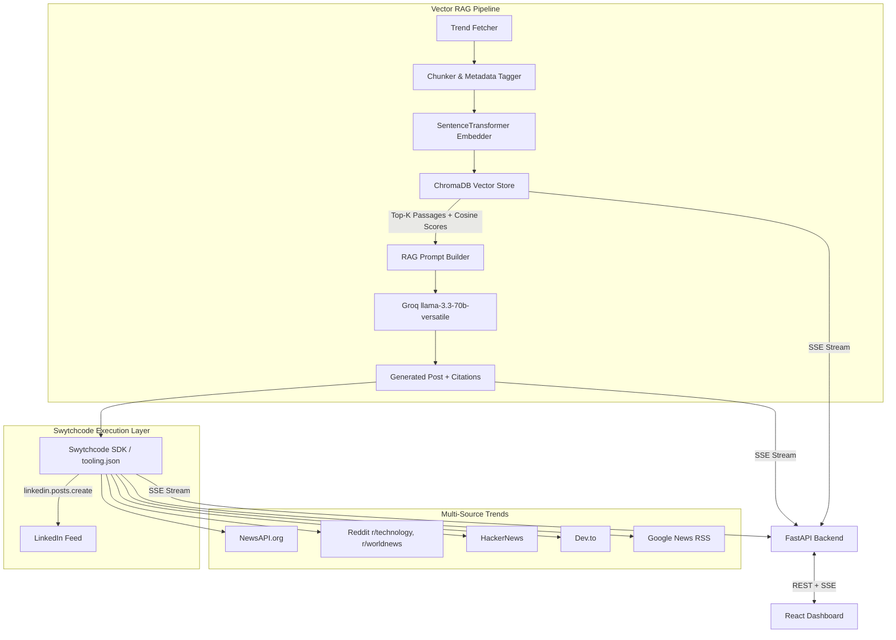

# TrendPulse

TrendPulse is an automated content generation and publishing pipeline. It retrieves real-time trending topics across **5 news and social chatter APIs**, indexes them into an in-memory **ChromaDB vector store**, retrieves relevant passages using cosine similarity vector search, generates grounded content with source citations using **Groq LLM (Llama 3.3 70B)**, and automatically posts to social channels via **Swytchcode**.

---

## Key Features

- **Multi-Source Trend Aggregation**: NewsAPI, Reddit (`r/technology`, `r/worldnews`, `r/programming`, `r/artificial`), HackerNews, Dev.to, and Google News RSS.
- **Swytchcode Policy Execution Layer**: All outbound fetches and social posting pass through Swytchcode's `tooling.json` policy engine with real-time audit logging.
- **Vector RAG Grounding**: Powered by ChromaDB & `sentence-transformers/all-MiniLM-L6-v2` to prevent hallucinations and provide exact citation tracing `[1], [2]`.
- **Fast LLM Generation**: High-throughput inference via Groq (`llama-3.3-70b-versatile`).
- **Daily Scheduler + Instant Trigger**: Automated cron scheduler (09:00 UTC) with a live **"Run Now"** trigger for instant demo execution.
- **Dark Glassmorphism Dashboard**: React + Vite UI featuring real-time Server-Sent Events (SSE) pipeline step visualizer, RAG vector inspector with similarity score bars, and Swytchcode audit table.

---

## Architecture Overview



---

## Quick Start Guide

### 1. Prerequisites
- Python 3.10+
- Node.js 18+
- Swytchcode CLI (`npx swytchcode`)

### 2. Environment Setup
Clone the repository and create `.env`:
```bash
git clone https://github.com/piyush28verma/TrendPulse.git
cd TrendPulse
cp .env.example .env
```

Fill in your API keys in `.env`:
```env
NEWSAPI_KEY=your_newsapi_key
GROQ_API_KEY=your_groq_api_key
LINKEDIN_CLIENT_ID=your_linkedin_client_id
LINKEDIN_CLIENT_SECRET=your_linkedin_client_secret
LINKEDIN_ACCESS_TOKEN=your_linkedin_access_token
LINKEDIN_PERSON_URN=urn:li:person:your_person_urn
```

Generate your LinkedIn access token automatically:
```bash
python3 get_linkedin_token.py
```

### 3. Install Dependencies

**Backend:**
```bash
pip install -r requirements.txt
```

**Frontend:**
```bash
cd frontend
npm install
```

### 4. Running locally

**Start Backend (FastAPI on http://localhost:8000):**
```bash
uvicorn backend.main:app --reload --port 8000
```

**Start Frontend (Vite on http://localhost:5173):**
```bash
cd frontend
npm run dev
```

---

## Swytchcode Policy Configuration (`tooling.json`)

```json
{
  "version": "1",
  "tools": [
    { "id": "newsapi.top_headlines.get", "description": "Fetch top tech news" },
    { "id": "reddit.hot_posts.get", "description": "Fetch hot Reddit posts" },
    { "id": "hackernews.topstories.get", "description": "Fetch HackerNews stories" },
    { "id": "devto.articles.get", "description": "Fetch Dev.to developer posts" },
    { "id": "googlenews.rss.get", "description": "Fetch Google News RSS" },
    { "id": "reddit.submit_post.post", "description": "Post generated content to Reddit" }
  ]
}
```

---

## License

MIT License
